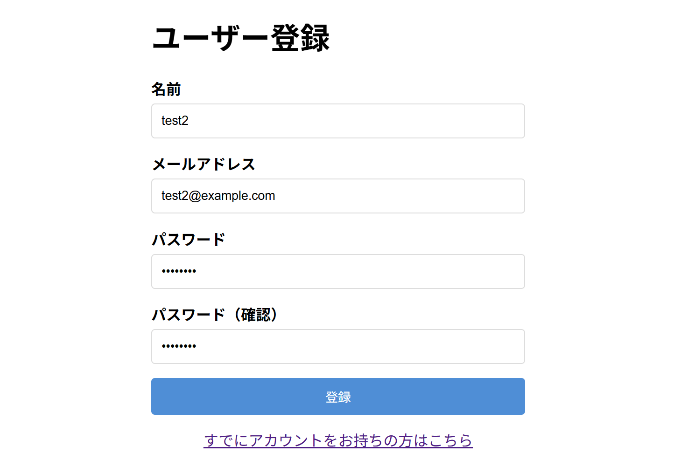
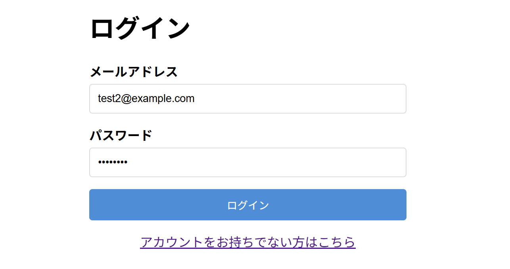
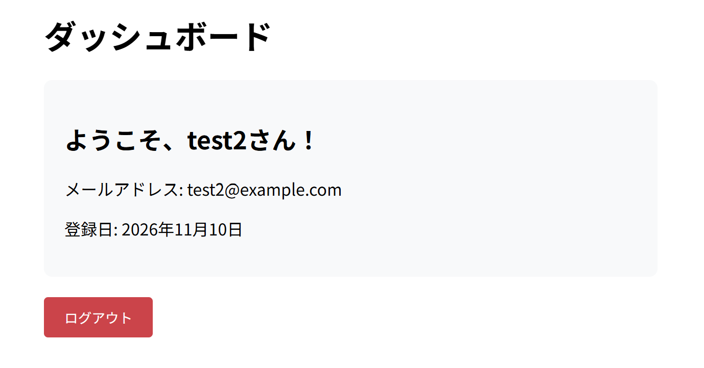

# auth-app-practice

## 概要
COACHTECH 教材 Tutorial 10-1「認証機能 ハンズオン演習」で作成した成果物です。
Laravel Fortifyを活用して、ユーザー登録、ログイン、ログアウト、ダッシュボード表示の機能を実装しました。

## 使用技術
- PHP 8.5.12
- Laravel 10.50.4
- Laravel Fortify（認証）
- MySQL

## 学んだこと
- Laravel Fortifyを活用したユーザー登録、ログイン、ログアウト機能の実装方法
- HOME定数を使用したリダイレクト設定や、FortifyServiceProviderでの表示するビューの指定方法
- authミドルウェアで認証済みのユーザーのみのルートを設定する方法、グループでまとめてauthミドルウェアを有効にする方法

## 動作確認
1. auth-app-practiceディレクトリ上でsail up -dコマンドによりyamlファイルに記述した構成通りのコンテナを起動させてネットワークで連携
2. sail artisan migrateコマンドによりテーブルを作成
3. ブラウザで「`http://localhost/register`」のURLにアクセスしてユーザー登録画面が表示されることを確認
4. 名前、メールアドレス、パスワードの各項目を入力してユーザー登録を行う
5. /loginにアクセスして作成したユーザー情報でログインを行う
6. /dashboardのダッシュボード画面に登録した情報が表示されており、ログアウト押下でLaravelのウェルカムページに遷移

## 開発の工夫
- authミドルウェアを活用し、認証済みのユーザーのみダッシュボード画面を表示し、未認証のユーザーは自動でログイン画面にリダイレクトするようにした
- sail artisan tinkerコマンドで登録済みのユーザー情報がデータベースに格納されていることの確認を行った

## 動作確認のスクリーンショット
1. ユーザー登録画面

   

2. ログイン画面

   
3. ダッシュボード画面

   